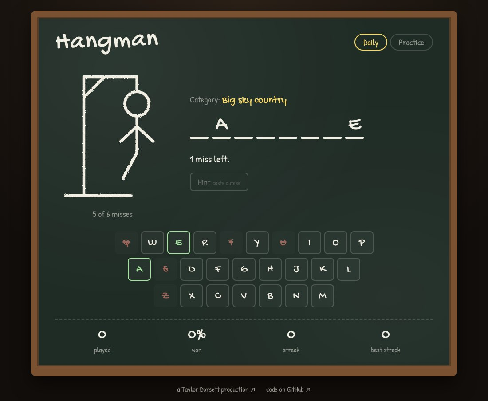

# Hangman

Hangman on a chalkboard. There's one daily puzzle that's the same for everyone, plus practice mode when one a day isn't enough.

Play it at [taylordorsett.com/hangman_javascript](https://www.taylordorsett.com/hangman_javascript/).



## Why?

This was one of the first things I ever built in JavaScript, back in 2020. It used a puzzle API from a course I was taking and needed webpack to run. I rebuilt it from scratch so it runs on my site with no build step, and so it's actually fun to play.

## What can it do?

* A new daily puzzle at midnight your time. Everyone gets the same one, and it goes through every puzzle before it repeats
* Practice mode deals a new word whenever you want and skips the ones you've seen lately
* Type or tap letters on the chalk keyboard. Hits turn green and misses get crossed out
* Six misses and you're hanged, one line of chalk at a time
* One hint per game shows a missing letter, but it costs a miss
* Share your daily result without spoiling the answer
* Tracks games played, win rate, your streak and your best streak
* Remembers a game in progress if you close the tab

The puzzles come in seven categories: poker night, video games, gym bag, big sky country, pizza shop, coding and animals.

## What tech?

Plain HTML, CSS and JavaScript modules. No framework and no build step. GitHub Pages hosts it.

| File | What it does |
| --- | --- |
| `index.html` | The page and the chalk drawing |
| `style.css` | The chalkboard |
| `game.js` | The rules: guesses, misses, hints, the daily puzzle and the share text |
| `app.js` | The keyboard, buttons, saving and drawing the page |
| `words.js` | Every puzzle and its category |

Saves live in localStorage. If your browser blocks storage the game still works, it just forgets when you leave.

## Running it locally

Serve the folder with anything that serves static files:

```sh
npx http-server .
```

The page uses JavaScript modules, so opening index.html straight from your files won't work.

## Testing

```sh
npm install
npx playwright install chromium
npm test
```

That runs the rule tests with Node's test runner, then plays the game in a real browser at phone and desktop sizes. GitHub Actions runs them on every PR, deploys the site when master changes, and posts a preview link on every PR.

## Adding puzzles

Add answers to a category in `words.js`, or add a new category. Answers are letters and spaces only. The tests check for that and for duplicates.

MIT license.
